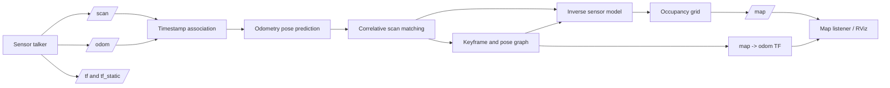
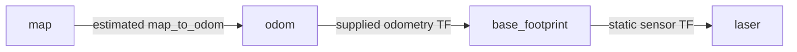
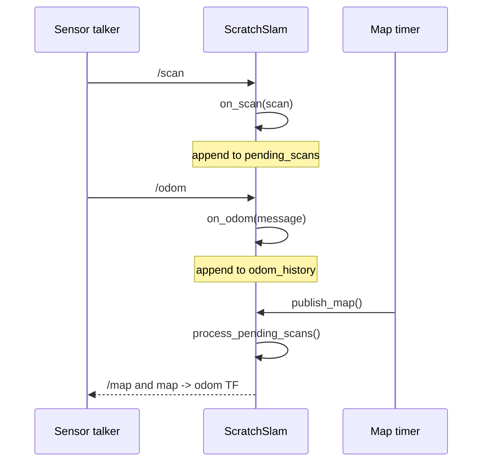

# Scratch SLAM: an academic implementation

This directory contains a small, readable online 2-D SLAM implementation in
[`slam_scratch/scratch_slam.py`](slam_scratch/scratch_slam.py). It is intended
for teaching, experimentation, and tracing the relationship between ROS
messages and the mathematical stages of SLAM.

It is not a replacement for SLAM Toolbox. It deliberately favors explicit
Python data structures and simple algorithms over production performance.

## Learning objectives

The example demonstrates how to:

- associate asynchronous laser and odometry messages by timestamp;
- use odometry as a motion prior;
- register a scan with a map using correlative scan matching;
- update a 2-D occupancy grid with an inverse sensor model;
- select keyframes and create odometry constraints;
- detect simple loop-closure candidates;
- relax a pose graph and rebuild a map after optimization;
- publish `nav_msgs/msg/OccupancyGrid` and `map -> odom` through ROS 2.

## ROS data flow

The live node consumes the same synthetic sensor topics used by the other
demos and publishes the map consumed by RViz or the map listener.



The current implementation does not perform a TF lookup for the laser
extrinsic transform. The synthetic talker places the laser directly above the
robot with zero planar offset, so the odometry pose is sufficient for this
demo. A production implementation should use timestamped TF interpolation.

## Coordinate frames

The node uses three planar transforms:



Internally, a pose is represented as `(x, y, yaw)`. If `T_map_odom` is the
estimated correction and `T_odom_base` is the odometry pose, the predicted
map-frame pose is:

```text
T_map_base = T_map_odom ∘ T_odom_base
```

The scan matcher searches around this prediction. After selecting a corrected
map pose `T_map_base*`, the transform published for the next iteration is:

```text
T_map_odom = T_map_base* ∘ inverse(T_odom_base)
```

## Algorithm

The implementation is timer-driven. Subscription callbacks only cache data;
`publish_map()` consumes queued scans, updates the SLAM state, and publishes a
coherent map/TF pair.

### 1. Startup and runtime call flow

`main()` calls `rclpy.init()`, constructs `ScratchSlam`, and enters
`rclpy.spin(node)`. The constructor creates the `/scan` and `/odom`
subscriptions, the `/map` publisher, the `map -> odom` broadcaster, and the
publication timer.



The main call chain for one scan is:

```text
publish_map()
└── process_pending_scans()
    ├── stamp_to_seconds()
    ├── closest_odom_pose()
    ├── compose_pose()                 # map-frame prediction
    ├── match_scan()
    │   ├── scan_returns()
    │   ├── search_pose()               # coarse
    │   │   └── scan_match_score() × candidates
    │   └── search_pose()               # fine
    │       └── scan_match_score() × candidates
    ├── should_create_keyframe()
    └── add_keyframe() when threshold is reached
        ├── inverse_pose() + compose_pose()  # odometry edge
        ├── integrate_scan()
        │   ├── filtered_range()
        │   ├── world_to_cell()
        │   ├── bresenham()
        │   └── update_cell()
        └── find_loop_closure()
            ├── scan_returns()
            ├── search_pose()
            ├── optimize_pose_graph() when accepted
            └── rebuild_map() when accepted
```

After the queue is processed, `publish_map()` calls `cell_value()` for every
grid cell, publishes `OccupancyGrid`, and calls
`publish_map_to_odom_tf()`.

### 2. Timestamp association

`on_odom(message)` calls `stamp_to_seconds()` and `quaternion_to_yaw()` and
stores `(timestamp, (x, y, yaw))` in a deque of length 200. `on_scan(scan)`
stores the scan in a deque of length 20. This avoids assuming that ROS callback
order is the same as publisher order.

When `process_pending_scans()` runs, `closest_odom_pose()` selects:

```text
argmin_(t_i in odom_history) |t_i - t_scan|
```

This implementation uses nearest-neighbor association. A production system
would normally interpolate TF or odometry and reject associations with a large
time gap.

`quaternion_to_yaw()` projects the ROS quaternion onto the planar yaw angle.
For quaternion components `(x_q, y_q, z_q, w_q)`, it uses:

```text
s = 2 * (w_q * z_q + x_q * y_q)
c = 1 - 2 * (y_q^2 + z_q^2)
yaw = atan2(s, c)
```

### 3. Pose prediction

The odometry pose is composed with the current `map -> odom` estimate:

```text
predicted_pose = compose_pose(map_to_odom, odom_pose)
```

For poses `A=(x₁,y₁,θ₁)` and `B=(x₂,y₂,θ₂)`, `compose_pose()` computes:

```text
x = x₁ + cos(θ₁)x₂ - sin(θ₁)y₂
y = y₁ + sin(θ₁)x₂ + cos(θ₁)y₂
θ = normalize(θ₁ + θ₂)
```

This prediction is the center of the scan-matching window. If the map is
empty, `match_scan()` returns it unchanged.

### 4. Range filtering

`filtered_range()` rejects NaN/infinite values, measurements outside the laser
limits, and isolated one-ray spikes when both neighboring rays agree.
`scan_returns(scan, stride=4)` additionally decimates valid obstacle returns
for matching:

```text
range_min <= range_i < range_max
```

Maximum-range measurements are excluded from matching because they do not
identify an obstacle endpoint.

For a retained beam index `i`, the bearing used by both matching and mapping
is generated from the scan metadata:

```text
bearing_i = angle_min + i * angle_increment
```

Thus the same `(range_i, bearing_i)` measurement is used consistently by
`scan_match_score()` and `integrate_scan()`.

### 5. Coordinate transforms and grid indexing

The implementation uses a planar rigid transform `(x, y, theta)` instead of a
full 3-D matrix. `compose_pose()` applies the rotation of the first pose to
the translation of the second pose. `inverse_pose()` is used when creating
odometry constraints and when publishing `map -> odom`. For
`T=(x,y,theta)`, its inverse is:

```text
T^-1 = (-R(-theta) * [x,y], -theta)

x_inv = -cos(theta) * x - sin(theta) * y
y_inv =  sin(theta) * x - cos(theta) * y
theta_inv = normalize(-theta)
```

`world_to_cell(x, y)` converts metres to integer grid coordinates using the
configured map origin and resolution:

```text
column = floor((x - origin_x) / resolution)
row    = floor((y - origin_y) / resolution)
```

The row is serialized into the ROS occupancy array as `row * width + column`.
`in_bounds()` checks `0 <= column < width` and `0 <= row < height` before any
map access. The fixed grid therefore clips rays that leave the configured map
window.

### 6. Correlative scan matching

`match_scan(scan, predicted_pose)` calls `scan_returns()` and then
`search_pose()` twice: first with a coarse lattice, then with a fine lattice
around the coarse result. For a candidate pose `T=(x,y,theta)`,
`scan_match_score()` performs:

1. Convert each polar return to laser-frame Cartesian coordinates:

   ```text
   p_laser = (range * cos(bearing), range * sin(bearing))
   ```

2. Transform the endpoint into the map frame:

   ```text
   p_map = (x, y) + R(theta) * p_laser
   ```

3. Convert `p_map` to a grid cell with `world_to_cell()`.
4. Sum positive occupancy evidence:

   ```text
   score(T) = sum(max(log_odds[cell(p_map_i)], 0))
   ```

`search_pose()` evaluates every combination of x offset, y offset, and yaw
offset. With the defaults, the coarse search uses ±0.30 m, ±0.30 rad, and
0.10 spacing. The fine search uses ±0.10 m, ±0.10 rad, and 0.04 spacing.
Unknown cells contribute zero, so an empty map cannot invent a correction.

### 7. Inverse sensor model

For every valid ray, `integrate_scan()` calls `world_to_cell()` for the sensor
and endpoint and calls `bresenham()` to enumerate the discrete ray:

```text
sensor_cell -> cell_1 -> ... -> cell_(n-1) -> endpoint_cell
```

The cells before a finite return are updated as free and the endpoint is
updated as occupied. A maximum-range ray has no occupied endpoint and only
contributes free-space evidence.

The map stores log odds rather than probabilities:

```text
l_t(m) = clamp(l_(t-1)(m) + update, -5, 5)
p(m)   = 1 / (1 + exp(-l(m)))
```

The ROS occupancy values are classified as:

| Internal state | Published value | Meaning |
| --- | ---: | --- |
| `log_odds > 0.619` | `100` | occupied (`p > 0.65`) |
| `log_odds < -1.408` | `0` | free (`p < 0.196`) |
| otherwise or absent | `-1` | unknown |

### 8. Keyframes and pose graph

Not every scan becomes a graph node. `should_create_keyframe()` compares the
current odometry pose with the previous keyframe:

```text
d = sqrt((x - x_prev)^2 + (y - y_prev)^2)
delta_theta = abs(normalize(theta - theta_prev))
```

The scan becomes a keyframe when `d >= keyframe_distance` or
`delta_theta >= keyframe_rotation`. `add_keyframe()` stores the scan, its
odometry pose, and its current map pose:

```text
keyframe = {
    scan: LaserScan,
    odom_pose: (x, y, yaw),
    pose: (x, y, yaw),
}
```

Consecutive keyframes create odometry constraints:

```text
T_i_j = inverse(T_odom_i) compose T_odom_j
```

The constraint says that the optimized poses should satisfy
`T_map_j approximately equals T_map_i compose T_i_j`. Each stored edge is the
tuple `(first_index, second_index, relative_pose, weight)`.

### 9. Loop closure and graph relaxation

After adding a keyframe, `find_loop_closure()` ignores the ten most recent
nodes, selects older nodes within `loop_closure_distance`, and calls
`search_pose()` around each candidate pose. A candidate is accepted when:

```text
score >= max(5.0, 5 * scan_match_min_score)
```

The relative pose from the candidate to the matched current pose becomes a
non-consecutive loop-closure edge with weight 0.5.

`optimize_pose_graph()` performs six passes over all constraints. For an edge
from node `i` to node `j`, it computes:

```text
target_j = compose(pose_i, relative_ij)
e_x       = target_x - pose_j.x
e_y       = target_y - pose_j.y
e_theta   = normalize(target_theta - pose_j.theta)
gain      = 0.20 * constraint_weight
```

Node zero is fixed to remove global translation/rotation ambiguity. If the
first node is zero, the update is applied to node `j`; otherwise half the
correction is applied to both endpoints. This is an educational relaxation
scheme, not a robust nonlinear least-squares solver.

After optimization, the latest keyframe defines the updated global correction:

```text
map_to_odom = pose_last compose inverse(odom_pose_last)
```

`rebuild_map()` then clears `log_odds` and calls
`integrate_scan(keyframe.scan, keyframe.pose)` for every stored keyframe. This
replay makes the loop-closure correction visible in the published map.

## Function reference

### ROS lifecycle and callbacks

| Function | Responsibility |
| --- | --- |
| `ScratchSlam.__init__()` | Declares parameters, validates configuration, initializes the sparse map and graph, and creates ROS publishers/subscribers/timers. |
| `on_odom(message)` | Converts an odometry quaternion to yaw and stores the timestamped planar pose. |
| `on_scan(scan)` | Queues a laser scan so it can be processed after odometry association. |
| `process_pending_scans()` | Runs pose prediction, scan matching, keyframe selection, graph updates, and scan integration. |
| `publish_map()` | Processes queued data, serializes the occupancy grid into an `OccupancyGrid`, and publishes the map and transform. |
| `publish_map_to_odom_tf(stamp)` | Publishes the current global correction as `map -> odom`. |
| `main(args)` | Initializes and spins ROS, then destroys the node during shutdown. |

### Mapping and filtering

| Function | Responsibility |
| --- | --- |
| `filtered_range(scan, index)` | Rejects invalid ranges and isolated single-ray spikes. |
| `scan_returns(scan, stride)` | Extracts finite obstacle returns for matching and optionally downsamples them. |
| `integrate_scan(scan, sensor_pose)` | Ray-traces one scan and applies free/occupied log-odds updates. |
| `update_cell(cell, update)` | Applies a bounded log-odds increment to an in-bounds cell. |
| `cell_value(cell)` | Converts an internal log-odds value to ROS occupancy values. |
| `rebuild_map()` | Replays all keyframes after pose-graph corrections. |
| `world_to_cell(x, y)` | Converts map-frame metres into local integer grid indices. |
| `in_bounds(cell)` | Prevents ray updates outside the fixed grid. |
| `bresenham(start, end)` | Enumerates grid cells crossed by a laser ray. |

### Scan matching and graph optimization

| Function | Responsibility |
| --- | --- |
| `match_scan(scan, predicted_pose)` | Performs coarse and fine correlative registration. |
| `search_pose(returns, center, translation_radius, rotation_radius, step)` | Exhaustively evaluates a 3-D candidate pose lattice. |
| `scan_match_score(returns, pose)` | Scores endpoint agreement with occupied map evidence. |
| `should_create_keyframe(odom_pose)` | Applies translation/rotation keyframe thresholds. |
| `add_keyframe(scan, odom_pose, map_pose, match_score)` | Adds a graph node, odometry edge, and possible loop edge. |
| `find_loop_closure(node_index)` | Searches historical candidates and returns a validated relative constraint. |
| `optimize_pose_graph()` | Relaxes graph constraints while anchoring the first pose. |

### Geometry and time utilities

| Function | Responsibility |
| --- | --- |
| `stamp_to_seconds(stamp)` | Converts a ROS timestamp to floating-point seconds. |
| `closest_odom_pose(stamp)` | Selects the nearest buffered odometry pose. |
| `compose_pose(first, second)` | Composes planar rigid transforms. |
| `inverse_pose(pose)` | Computes a planar transform inverse. |
| `normalize_angle(angle)` | Wraps yaw to `[-π, π)`. |
| `quaternion_to_yaw(quaternion)` | Extracts planar yaw from a ROS quaternion. |

## Parameters

| Parameter | Default | Description |
| --- | ---: | --- |
| `resolution` | `0.05` | Grid cell size in metres. |
| `width`, `height` | `240` | Fixed grid dimensions. |
| `origin_x`, `origin_y` | `-6.0` | World location of grid cell `(0, 0)`. |
| `ray_limit` | `10.0` | Maximum range integrated. |
| `occupied_update` | `3.0` | Positive occupied log-odds increment. |
| `free_update` | `-2.0` | Negative free-space log-odds increment. |
| `publish_period` | `0.1` | Map publication period in seconds. |
| `scan_match_translation` | `0.30` | Coarse x/y search radius in metres. |
| `scan_match_rotation` | `0.30` | Coarse yaw search radius in radians. |
| `scan_match_min_score` | `1.0` | Minimum score to accept a correction. |
| `keyframe_distance` | `0.10` | Translation threshold for a keyframe. |
| `keyframe_rotation` | `0.10` | Rotation threshold for a keyframe. |
| `loop_closure_distance` | `0.80` | Candidate loop proximity threshold. |

## Running the demonstration

From the workspace containing this package and `slam-dummy`:

```bash
colcon build --symlink-install --packages-select slam_dummy slam_scratch
source install/setup.bash
ros2 launch slam_scratch slam_scratch.launch.py \
  pattern_period:=10.0 \
  publish_period:=0.1 \
  start_delay:=1.0 \
  map_update_period:=2.0 \
  dump_every_n_maps:=1 \
  dump_directory:=slam_maps_live
```

Expected behavior:

- the synthetic talker publishes `/scan`, `/odom`, and TF;
- `scratch_slam` reports its configured map size;
- `/map` is published periodically;
- the listener writes PGM/YAML/input snapshots;
- loop-closure messages may appear after enough keyframes have accumulated.

Inspect the live graph with:

```bash
ros2 topic echo /map --once
ros2 topic hz /scan
ros2 run tf2_tools view_frames
```

## Scope and limitations

This implementation is suitable for understanding the algorithmic flow, but
its output should not be interpreted as pixel-equivalent to SLAM Toolbox.
Important differences include:

- fixed map bounds rather than dynamic map expansion;
- nearest-neighbor odometry association rather than TF interpolation;
- exhaustive local search rather than a production scan matcher;
- heuristic loop-closure acceptance;
- six-pass relaxation rather than a robust nonlinear optimizer;
- no submaps, robust kernels, covariance weighting, or probabilistic data
  association;
- simplified handling of the synthetic moving environment.

These limitations are useful teaching points: each can be replaced by a more
advanced component while retaining the same ROS interfaces and overall data
flow.
